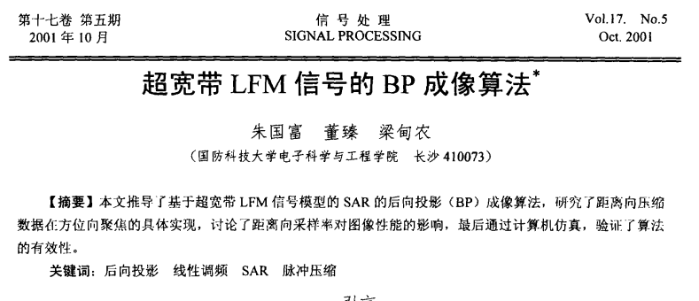
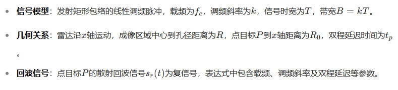
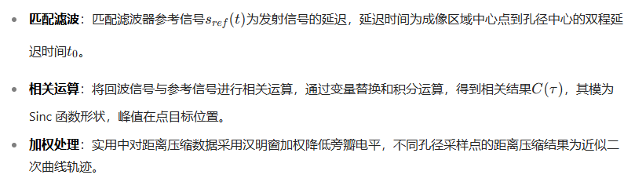
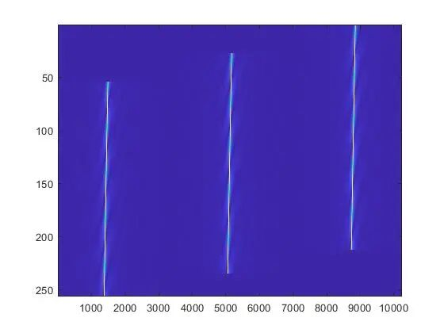
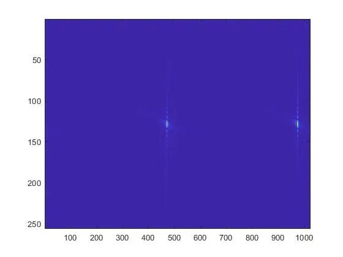
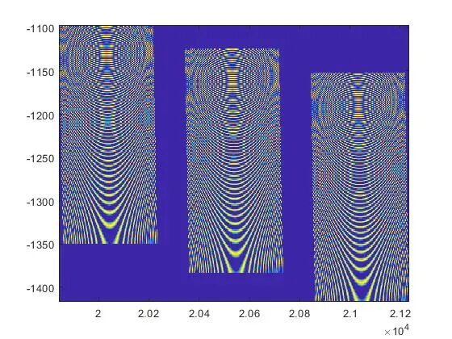

# Radar Imaging: BP Imaging Algorithm for Ultra-Wideband LFM Signals [with MATLAB Code]

1. Research Background and Purpose
The traditional narrow-band SAR relies on the Fresnel approximation, whereas ultra-wideband wide-beam SAR has a relative bandwidth greater than 25% and an antenna horizontal beam angle greater than 30°. The Fresnel approximation is no longer valid, and traditional views cannot explain the issue of improved azimuth resolution.
Purpose
To derive the BP back projection imaging algorithm based on the ultra-wideband LFM signal model, study the realization of azimuth focusing with distance-axis compression data, explore the impact of distance-axis sampling rate on image performance, and verify the effectiveness of the algorithm through simulation.
2. Ultra-wideband LFM Signal and Target Backscatter Model
3. Azimuth-axis pulse compression
4. Azimuth-axis pulse compression - BP algorithm focusing principle
The BP algorithm is a time-domain coherent focusing method that aligns the received signals along a quadratic curve trajectory for azimuth-axis coherence focusing.
Imaging formula
Under ideal impulse pulses, image pixel values are the sum of the received signal at corresponding times from the aperture sampling points; for LFM signals, complex form distance compression results need to be substituted into the BP algorithm formula. Complex addition allows target coherent accumulation, while sidelobes and noise are randomly added, thus achieving low sidelobes and high resolution images.
5. Impact of Azimuth-axis Sampling Rate on BP Algorithm Dispersion
Actually received signals are discrete, and if the sampling point is not at the peak of the Sinc function, the deviation of the target echo accumulation point from the peak can cause dispersion, affecting azimuth-axis resolution and sidelobe level.
Sampling rate impact
Higher sampling frequency leads to smaller sampling intervals, closer accumulation points to the peak, and better focusing performance; conversely, it worsens focusing performance.
Improvement methods
Increasing sampling rate can improve focusing performance, but it increases system development difficulty; downsampling under low sampling rates is an effective means, but due to the narrow pulse width of ultra-wideband LFM signal compression, interpolation has errors and large computations, requiring balancing according to specific circumstances.
MATLAB Simulation Results

## Images

<!-- PAYMENT_BLOCK -->

## Get this dataset

- Payment link (Stripe): [Buy now](https://buy.stripe.com/3cs8yP7sY87d0vu9AB)
- Payment QR code: 

<!-- /PAYMENT_BLOCK -->
